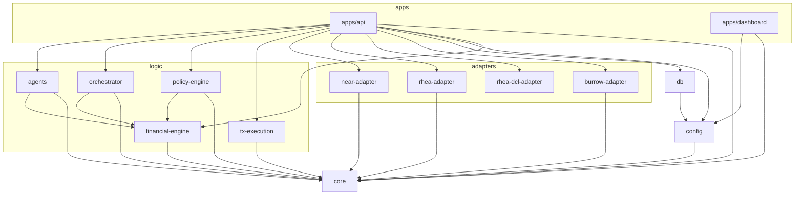
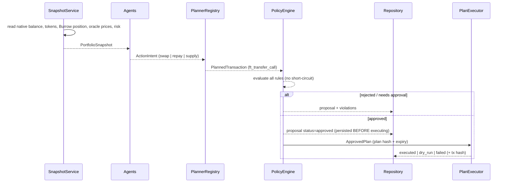

# Architecture

## Principles

1. **Ports and adapters.** `@near-autopilot/core` defines every interface the system needs
   (`ContractViewer`, `TokenReader`, `PriceOracle`, `LendingReader`, `SwapQuoter`, `ProtocolPlanner`,
   `TransactionSigner`, `TransactionBroadcaster`, `PlanExecutor`, `Agent`, `Clock`, `Logger`, ...).
   Business logic depends on these interfaces, never on a concrete chain client.
2. **No fake integrations.** Every adapter talks to the real chain (JSON-RPC view calls, real contract
   methods). Test doubles exist only for the port interfaces, live in `core/testing` or in test
   directories, and cannot be imported by production code (lint + CI enforced).
3. **Fail closed.** Missing prices, unknown response shapes, stale data, unregistered storage, unknown
   recipients: all stop the action rather than guessing.
4. **Policy is the only door to execution.** The executor accepts `ApprovedPlan`, a branded type only
   `PolicyEngine.approve()` mints.
5. **Exact arithmetic.** Token amounts are `bigint`; USD values are `bigint` micro-USD; ratios are basis points.
   Floating point appears only in display values (health factor as a `number`).

## Layers and allowed dependencies

Rules that follow from this (all checked by `scripts/check-boundaries.mjs` and ESLint):

- Adapters never import each other. Rhea/Burrow reach the chain through the `ContractViewer` port; the
  concrete `NearContractViewer` is injected by `apps/api/src/wiring.ts`.
- `agents`, `policy-engine`, `tx-execution` never import an adapter. They see only core ports.
- The dashboard cannot import adapters, the DB, or engines; it speaks the wire contract over HTTP.
- `core` stays isomorphic: `node:*` is allowed only in `hash.ts` (entry `@near-autopilot/core/hash`) and the test doubles.
- No cycles.

`apps/api/src/wiring.ts` is the only composition root where concrete adapters are bound to ports.

## The pipeline

`AutopilotCycle` (`apps/api/src/services/cycle.ts`):

- Runs at most one cycle at a time (`409` for overlap).
- Consults agents in order (guardian first). In `live` mode it stops after the first transaction is sent
  because the snapshot is stale afterwards.
- A failing agent is logged and audited; it does not fail the run.
- Persists the `approved` row and audit event before calling the executor, so a crash mid-send leaves a
  visible record.

## Packages

### core

Branded ids (`AccountId`), domain types, `ActionIntent` union (swap, repay, supply; deliberately no
borrow/withdraw), `PlannedTransaction`, `ApprovedPlan`, ports, errors, USD helpers, canonical JSON, and the
API wire contracts (Zod). Entry points: `.`, `./hash` (node-only), `./testing` (test doubles).

### financial-engine

Pure functions: `valueUsd`/`rawForValueUsd`, `lendingTotals`, `healthFactor`,
`repayAmountForTargetHealthFactor`, `collateralValueForTargetHealthFactor`, `minAmountOut`,
`oracleDeviationBps`, `computeAllocation`, `planRebalance`, `valuePortfolio`. Prices use the oracle's native
`multiplier / 10^decimals` USD-per-raw-unit form, so valuation never needs token decimals or floats.
Health factor follows Burrow's definition: `Σ collateral × collateralFactor ÷ Σ debt ÷ borrowFactor`.

The package also holds the deterministic financial engine (all `bigint`, explicit rounding, no floats):
`clmm` (concentrated-liquidity valuation, fee growth), `amm` (constant-product and v3-style quotes, slippage),
`impermanent-loss`, `yield` (fee APR, net yield; realized, marked and estimated are separate types),
`rebalance` (swap sizing and cost), `risk` (health factor, liquidation buffers and prices, stress tests,
liquidation simulation) and `allocate` (exact constrained allocation). Every assumption and limitation is in
[financial-engine.md](financial-engine.md).

### near-adapter

`NearRpcClient` (timeouts, bounded retries on idempotent reads only, never retries broadcasts),
`NearContractViewer`, `NearAccountReader` (spendable balance net of storage reserve), `NearTokenReader`
(NEP-141 + NEP-145), `NearChainContextProvider` (nonce + block hash), `NearTransactionBroadcaster`
(waits for `FINAL`, treats a failed receipt anywhere in the tree as failure).

### rhea-adapter

`RheaSwapQuoter` calls the exchange's `get_return` on operator-listed pools and picks the best.
`RheaPlanner` builds the instant-swap `ft_transfer_call` and refuses to plan if the output token's storage
is not registered for the signer (the output would otherwise be stranded).

### rhea-dcl-adapter

Rhea/Ref **v2 concentrated liquidity**, kept separate from `rhea-adapter` (which talks to the v1 AMM). It has
four layers: `RheaDclClient` (read-only, strict Zod-validated views over the core `ContractViewer` port),
`math` (exact bigint tick and liquidity arithmetic ported from Rhea's frontend), `messages` (pure builders
that return `FunctionCallAction`s and never sign), and `wasm-exports` (`verifyDeployedAbi`: reads the
deployed WASM's export table over `view_code` to prove a method name exists on a given deployment).
It depends only on `core`; it is not yet wired into the agents or the API. What is verified, and against
what, is in [rhea-dcl-capability-matrix.md](rhea-dcl-capability-matrix.md).

### burrow-adapter

Depends only on `core`. Read side: `BurrowClient` (`get_config`, `get_asset`, `get_assets_paged_detailed`,
`get_account`, `storage_balance_of`) and `BurrowOracleClient` (`get_price_data`), all Zod-validated, in Burrow's
**inner** units; `BurrowLendingReader`/`BurrowPriceOracle` adapt them to the core ports (converting inner → raw
with `extra_decimals`, and refusing prices if Burrow is configured with an unexpected oracle).

Risk side (`risk.ts`): pure bigint reproduction of the contract's liquidation rule (`volatility_ratio` weights
collateral and divides debt; equality is safe): health factor, LTV, liquidation threshold, max liquidation
discount, stress scenarios and per-asset breakeven moves.

Write side: `BurrowVerifier` mints `VerifiedBurrowDeployment`/`VerifiedBurrowToken` proofs after checking the RPC's
chain id, the code actually deployed at Burrow, its oracle and the token (using `core`'s `assertChainId` and
`checkExportedMethods`). `buildRepay`, `buildSupply`, `buildSupplyAsCollateral` and
`buildIncreaseCollateralFromSupplied` accept only those proofs; `BurrowPlanner` composes them. Borrow and
withdraw are intentionally not implemented. Evidence and gaps: [burrow-capability-matrix.md](burrow-capability-matrix.md).

### agents

`HealthGuardianAgent` sizes repayments/collateral with exact bigint maths and caps by wallet holdings.
`RebalancerAgent` plans one capped trade and derives the slippage floor from a live quote. Agents are
pure: they observe a snapshot and return intents.

### orchestrator

Coordinates Market Intelligence, LP Optimizer, Liquidation Guardian and Capital Allocator. Agents return untrusted
`unknown`; a strict schema + capability table turns it into typed proposals (no field can carry a receiver, method, key
or signature). A pure `decide()` re-derives value, risk, size, benefit and cost and ranks candidates; the policy engine,
injected through a port, separately authorises; a final re-check and a mode check run before `policy.approve`. Provides
no-action decisions, stale-data protection, cycle- and action-level idempotency with an in-doubt protocol, a fail-closed
hash-chained audit log, risk escalation, and an emergency read-only mode. It depends only on `core` and
`financial-engine`; `policy-engine` and `tx-execution` are test-only dependencies. Persistence ports have in-memory
reference implementations only, and it is not yet wired into `apps/api`. See [orchestrator.md](orchestrator.md).

### policy-engine

Config schema (strict, cross-validated) and 12 rules. The engine re-values every intent from oracle prices
itself (never trusting the agent), checks the plan matches the intent byte-for-byte on the fields that move
money, and produces a decision with every violation. `approve()` binds an approval to a SHA-256 of the
canonical plan with a TTL.

### tx-execution

`PlannerRegistry`, `verifyApproval` (expiry + plan hash), `TransactionExecutor` (verify → nonce/block hash →
sign → broadcast; one-time-use approvals), `DryRunExecutor` (same verification, no signing, reports `dry_run`).

### db

Drizzle schema for `runs`, `proposals`, `audit_events` (append-only), client factory and migrator. The
migration SQL is committed in `packages/db/drizzle`; generate new ones with `pnpm db:generate`.

### apps/api

Fastify server (bearer auth with constant-time compare, Zod-validated queries, generic 500s), the cycle,
snapshot service (+15 s cache for dashboard polling), Drizzle repository, wiring, scheduler.

### apps/dashboard

Next.js App Router, server components only talk to the API (the token never reaches the browser),
responses are re-validated against the shared Zod contracts.

## Data model

- `runs(id, account_id, status, started_at, finished_at, error, snapshot jsonb)`
- `proposals(id, run_id → runs, agent_id, kind, summary, reason, intent jsonb, value_usd_micro, status,
violations jsonb, plan_hash, execution_mode, tx_hash, error, created_at, updated_at)`
- `audit_events(id, at, type, run_id, proposal_id, payload jsonb)` — append-only

Proposal `status`: `rejected | approved | requires_approval | planning_failed | dry_run | executed | failed`.
`approved` is transient; a row left in it means execution did not resolve and needs manual reconciliation.

## Extending

- **New protocol:** add `packages/<name>-adapter` depending only on `core`; implement `SwapQuoter`/`LendingReader`/`ProtocolPlanner`;
  register it in `wiring.ts`; add it to `boundaries.config.mjs`; extend `ActionIntent` and policy rules.
- **New agent:** implement `Agent` in `packages/agents`, register in `wiring.ts`. It can only emit existing intent kinds.
- **New policy rule:** add a `Rule` to `packages/policy-engine/src/rules.ts` and `DEFAULT_RULES`; add a test.
